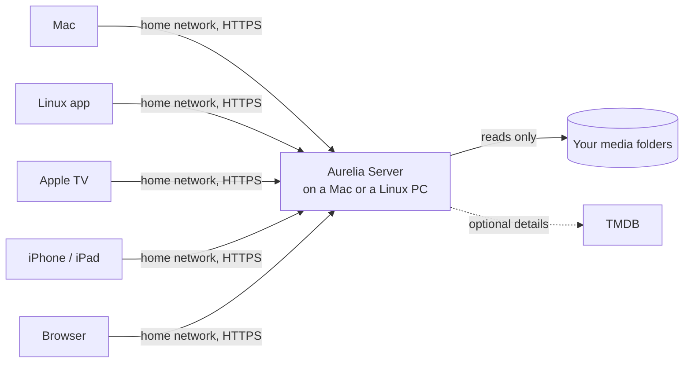

# Aurelia

**Your own movie and TV library, at home.**

A self-hosted media server for Mac or Linux, with native apps for Mac, Linux, Apple TV, iPhone and iPad,
and a player in any web browser.

Aurelia turns the movies and series on your own drives into a library that looks and feels like
the Apple TV app: posters and backdrops, seasons and episodes, Continue Watching across devices
and a profile for everyone at home. Your files stay exactly where they are, and nothing leaves
your home network unless you want it to.

## At a glance

| | |
| --- | --- |
| **What it is** | A media server plus apps, like a private streaming service for your own files |
| **Server** | Inside the Mac app, or on its own on a Linux PC (x64 or arm64) |
| **Watch on** | Mac, Linux, Apple TV, iPhone, iPad and any browser on your home network |
| **Plays** | The original files, with all their audio and subtitle tracks; browsers get MKV and other formats converted live |
| **Profiles** | One per person, with their own progress, favorites, Watchlist and history; PIN protection |
| **Your data** | Stays on your hardware. No account, no cloud, no tracking. Online details are optional |
| **Cost** | Free. Releases are published here on GitHub |
| **Status** | In active development; the interface is in English |

## Why Aurelia

- **Your files stay untouched.** Aurelia only reads your media. It never renames, moves or
  converts files on disk, and it keeps no transcode cache that fills your drive.
- **Native apps, not a website in a frame.** The Mac, Linux, Apple TV, iPhone and iPad apps are
  built for each system and play the original files with every audio and subtitle track.
- **No account and no cloud.** The server runs on your own computer. Nothing is sent out except
  optional TMDB and OpenSubtitles lookups and update checks.
- **Easy to run.** Host the library inside the Mac or Linux app, or on an old PC as a small
  server that sleeps when nobody watches and wakes when you open Aurelia.

## Highlights

**A library that organizes itself.** Movies, series, seasons, episodes, extras and trailers
are recognized from your folders. An import preview shows what was found before anything is
added. Details and artwork come from TMDB if you want them (with your own free token): Aurelia
compares title, year and, for series, the seasons and episodes you have, so most titles match
without asking. Everything can be edited, and your corrections survive later scans.

**Made for watching.** Fullscreen playback of the original files with remembered audio and
subtitle choices per profile and series, subtitle files next to the video, subtitles from
OpenSubtitles (by hand or automatically, with your own free key), timeline previews,
a sleep timer, Dialogue Boost, Volume Leveling and Up Next for series. *Play On* sends a title to
another screen at home, and *Watch Together* keeps several screens on the same moment.

**Everyone has their own profile.** Progress, favorites, Watchlist, collections, scene notes and
viewing history are separate per person. Profiles can be limited to chosen libraries or titles
and protected with a PIN; owner and administrator profiles always are.

**Collections and statistics.** Your own collections, smart lists that fill themselves by
genre, year, rating or watched state, film franchises together, and your watch time, streaks
and a year in review, private to your profile.

**A server that gets out of the way.** On Linux it can sleep when nobody watches and wakes by
Wake-on-LAN when you open Aurelia. Server Health and Library Health show free space, warnings,
duplicates and missing titles. The database is backed up and checked every day, and updates
install from the app.

## Apps

| | Runs on | What it does |
| --- | --- | --- |
| **Aurelia for Mac** | macOS 26 or later, Apple silicon (Intel Macs: up to 1.25.1) | Watch, manage the library, host the server or connect to one |
| **Aurelia for Linux** | Linux x64, Wayland or X11 | Watch, manage the library, host the server or connect to one; deb, rpm, Arch and Flatpak downloads |
| **Aurelia for Apple TV** | tvOS 26 or later | Watch on the big screen; pairs with your server by code |
| **Aurelia for iPhone & iPad** (preview) | iOS and iPadOS 26 or later | Touch-first app with activity, PIN and playback settings; installed from source, see [iPhone and iPad](docs/IOS_APP.md) |
| **Aurelia Server for Linux** | x64 and arm64 with systemd, e.g. Ubuntu | Runs the library on its own, sleeps when unused, updates from GitHub |
| **Aurelia in a browser** | Safari, Chrome, Edge or Firefox at home | Browse and watch without installing anything |

## Install

| | How |
| --- | --- |
| **Mac** | Download the disk image from the [latest release](../../releases/latest), open it and drag Aurelia to Applications. It updates itself. |
| **Linux server** (Ubuntu, Debian) | One line, then answer a few questions: `curl -fsSL https://raw.githubusercontent.com/lucaskleinsteuber/Aurelia/main/packaging/linux/get-aurelia.sh \| sudo bash`. More in [Aurelia Server on Linux](docs/LINUX_SERVER.md). |
| **Docker** (NAS) | Save one `compose.yaml` and run two commands; see [Aurelia Server with Docker](docs/DOCKER.md). |
| **Linux desktop app** | deb, rpm, Arch or Flatpak from the newest **Aurelia for Linux** release; see [installing Aurelia for Linux](docs/LINUX_APP.md#installation). |
| **Apple TV, iPhone, iPad** | Not in the App Store; build them from source with Xcode, see [tvOS](clients/tvos/README.md) and [iPhone and iPad](docs/IOS_APP.md). |
| **Any browser** | Nothing to install: open the server's address at home (below). |

The Mac app is free and does not use Apple's paid developer program. For now it is signed for
development and runs only on Macs registered for its developer account; a download for every
Mac is planned. [Distribution and updates](docs/FREE_DISTRIBUTION.md) explains signing and how
updates keep your library and settings.

## Getting started

1. **Set up the server.** Open Aurelia on a Mac or Linux PC and choose whether this computer hosts
   your library or connects to an existing server. On a new host, create the owner profile, add
   your media folders and confirm the import preview. On a Linux PC without a screen, the
   one-line install above asks the same questions.
2. **Connect your devices.** Apple TV, iPhone, iPad and browsers find the server on your network
   and show an 8-digit code. Approve it on the Mac with *Enter Code from Apple TV or Browser…*.
   Another Mac or Linux PC connects with a pairing code from the host's device settings.
3. **Choose your profile and watch.**

## Versions and updates

Each app has its own version number (for example Mac 1.28.0 and Linux server 1.28.0), because a
change in one app does not need a new version of the others. Every
[release page](../../releases) ends with the current version and download of every app, so
you never have to search for the newest Linux package.

Stable releases come about once or twice a week. Test versions come first as **betas** (marked
*Pre-release* on GitHub) and are offered only to apps that turned on **Beta updates** in
Settings › Updates; a Linux server joins with `sudo aurelia update --beta on`.

## Watching in a browser

While the server is on, open its address in a browser at home, for example
`https://192.168.1.50:43111`. The Mac app shows it with Copy and Open buttons under
*Settings › Server › Devices › Web Browser*. Continue past the certificate warning the first time
(the server signs its own certificate), approve the code on the Mac, choose your profile and
watch. Files the browser can't open itself, such as MKV, play converted live; nothing converted
is ever stored. More in [Aurelia in a web browser](docs/WEB_APP.md).

## Privacy and safety

- **Video files are only ever read.** Aurelia never modifies, moves or copies them and never
  stores converted video. Removing a title from the library never deletes its file.
- **Offline media keeps its place.** A missing drive keeps details, favorites and progress until
  you remove the title.
- **Encrypted at home too.** Apps talk to the server over HTTPS and remember its fingerprint, so
  another computer can't pose as your server. Devices join only with a code you approve.
- **Profiles stay private.** History, statistics and personal collections belong to one profile;
  administrators can't read them. See the [security model](docs/SECURITY_MODEL.md).
- **No cloud.** The server runs on your hardware and sends nothing out, except optional TMDB
  and OpenSubtitles lookups and update checks on GitHub. Away from home, you connect through your own VPN; see
  [Watching away from home](docs/REMOTE_ACCESS.md).

## Documentation

| Guide | Covers |
| --- | --- |
| [Aurelia Server on Linux](docs/LINUX_SERVER.md) | Installing, updating, power saving and media drives |
| [Aurelia Server with Docker](docs/DOCKER.md) | Running the server on a NAS or with Docker Compose |
| [Watching away from home](docs/REMOTE_ACCESS.md) | A VPN through the FRITZ!Box or Tailscale; why no port forwarding |
| [Aurelia for Linux](docs/LINUX_APP.md) | Installing the desktop app, hosting on a PC, updates and verification |
| [iPhone and iPad](docs/IOS_APP.md) | What the preview does and how to install it on your own device |
| [Aurelia in a web browser](docs/WEB_APP.md) | Signing in, what plays in a browser, and its limits |
| [Security model](docs/SECURITY_MODEL.md) | Profiles, roles, pairing and what administrators can do |
| [Backups and recovery](docs/DATABASE_RECOVERY.md) | Keeping the library database safe |
| [Audio processing](docs/AUDIO_PROCESSING.md) | Dialogue Boost, Volume Leveling and their limits |
| [Distribution and updates](docs/FREE_DISTRIBUTION.md) | Signing, Gatekeeper and keeping local builds running |
| [Client protocol](docs/CLIENT_PROTOCOL.md) and [compatibility](docs/CLIENT_COMPATIBILITY.md) | How the apps talk to the server |
| [Build and verification](docs/TRANSPORT_TESTING.md) | Building from source and running the checks |
| [Changelog](CHANGELOG.md) | Changes by product and version |
| [MIT license](LICENSE) | Copyright (c) 2026 Lucas Kleinsteuber |
| [Third-party notices](THIRD_PARTY_NOTICES.md) | Licenses of included components |
