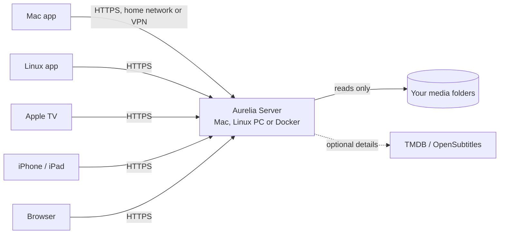

<div align="center">


# Aurelia

**Your own movies and TV shows, in a library that feels like a streaming service, on your own hardware.**

A free, self-hosted media server for Mac, Linux or a NAS, with native apps for
Mac, Linux, Apple TV, iPhone and iPad, and a player in any web browser.

[](../../releases/latest)
[](LICENSE)


[What it is](#what-aurelia-is) · [Features](#what-it-can-do) · [Downloads](#downloads) ·
[Get started](#get-started) · [Away from home](docs/REMOTE_ACCESS.md) ·
[Guides](docs/README.md) · [Screenshots](#screenshots)

</div>

## What Aurelia is

You have movies and series on a drive. Aurelia turns them into a library with posters,
descriptions, seasons, cast and trailers, remembers where everyone stopped, and plays them on
your TV, computer, tablet and phone, like a private streaming service for files you already own.

It has two parts:

- **The server** keeps the library. It runs inside the Mac or Linux app, on its own on a Linux
  PC (also an old laptop or a Raspberry Pi class computer), or in Docker on a NAS. It only ever
  *reads* your media folders.
- **The apps** browse and play: on Mac, Linux, Apple TV, iPhone, iPad and in any browser at home.

There is no account, no cloud and no subscription. Everything stays on your hardware and in your
home network; details and artwork from [TMDB](https://www.themoviedb.org) are optional.

## What it can do

**A library that organizes itself**
- Recognizes movies, series, seasons, episodes, extras and trailers from your folders, and shows
  what it found in an import preview before anything is added.
- Fetches details, artwork and the complete cast and crew from TMDB with your own free key, and
  matches by title, year and, for series, the episodes you have. Everything can be edited, and
  your corrections survive later scans.
- Collections: whole film series in release order, shared universes (for example Marvel or
  Middle-earth, movies and series together), your own collections and smart lists that fill
  themselves by genre, year, rating or watched state.

**Made for watching**
- Plays the original files with every audio and subtitle track, subtitle files next to the
  video, and subtitles from OpenSubtitles (with your own free key).
- Timeline previews, Up Next for series, a sleep timer, Dialogue Boost, Volume Leveling and the
  time a title ends.
- *Play On* sends a title to another screen at home; *Watch Together* keeps several screens on
  the same moment.
- Downloads on Mac, Linux, iPhone and iPad for watching without the server, with an offline
  mode when the server is out of reach.

**For everyone at home**
- A profile per person with their own progress, favorites, Watchlist, collections, scene notes,
  history and statistics (watch time, streaks, a year in review). Administrators cannot read them.
- PIN protection, age limits (FSK) and profiles limited to chosen libraries or titles.

**A server that gets out of the way**
- Sleeps when nobody watches and wakes by Wake-on-LAN when you open an app.
- Server Health and Library Health show free space, warnings, duplicates and missing titles.
- Daily database backups and checks; updates from the app or with one command.

**Private by design**
- Your files are never moved, renamed, converted or deleted, and no converted video is ever stored.
- Apps talk to the server over HTTPS and pin its certificate; new devices join only with a code
  you create. See the [security model](docs/SECURITY_MODEL.md) and the [privacy policy](docs/PRIVACY.md).

## Downloads

Every app has its own release on the [releases page](../../releases). Choose the download for
your system **and processor**:

| App | System | Download |
| --- | --- | --- |
| **Aurelia for Mac** | macOS 26, **Apple silicon** (M1 and newer) | `Aurelia-<version>-macOS-arm64.dmg` |
| | macOS 26, **Intel** | `Aurelia-<version>-macOS-x64.dmg` |
| **Aurelia for Linux** (desktop app) | Ubuntu, Debian, Mint · **x64** / **arm64** | `…-amd64.deb` / `…-arm64.deb` |
| | Fedora, openSUSE · **x64** / **arm64** | `…-x86_64.rpm` / `…-aarch64.rpm` |
| | Arch, CachyOS, Manjaro · **x64** / **arm64** | `…-x86_64.pkg.tar.zst` / `…-aarch64.pkg.tar.zst` |
| | Any distribution with Flatpak · **x64** | `…-x86_64.flatpak` |
| **Aurelia Server for Linux** | systemd Linux · **x64** / **arm64** | One-line install, or `…-linux-x64.tar.gz` / `…-linux-arm64.tar.gz` |
| **Aurelia Server with Docker** | NAS or any Docker host · amd64 / arm64 | Built on your machine, see [Docker](docs/DOCKER.md) |
| **Aurelia for Apple TV** | tvOS 26 | Built from source with Xcode, see [Apple TV](docs/APPLE_TV.md) |
| **Aurelia for iPhone & iPad** | iOS and iPadOS 26 | Built from source with Xcode, see [iPhone and iPad](docs/IOS_APP.md) |
| **Aurelia in a browser** | Safari, Chrome, Edge, Firefox | Nothing to install: open the server's address |

Not sure which processor you have? On a Mac: Apple menu › About This Mac (it says *Chip: Apple M…*
or *Processor: Intel*). On Linux: run `uname -m` (`x86_64` means x64, `aarch64` means arm64).

> [!NOTE]
> Aurelia is free and does not use Apple's paid developer program. The Mac download is
> development-signed and currently runs only on Macs registered to the developer's account;
> on any other Mac, build it from source with a free Apple ID. The Apple TV, iPhone and iPad
> apps are not in the App Store and are installed from source the same way.
> [Distribution and updates](docs/FREE_DISTRIBUTION.md) explains why.

## Get started

1. **Pick the computer that keeps the library.** A Mac or Linux PC that is on when you watch,
   with your media drives attached. For a computer without a screen, install the Linux server
   with one line:
   ```sh
   curl -fsSL https://raw.githubusercontent.com/lucaskleinsteuber/Aurelia/main/packaging/linux/get-aurelia.sh | sudo bash
   ```
2. **Set it up.** Open Aurelia, choose *Set Up This Mac* (or *Set Up This PC* on Linux), create the owner profile, add your
   media folders and confirm the import preview. Add your free TMDB key for posters and details.
3. **Connect your other devices.** On the server computer choose *Settings › Profiles and Devices ›
   Create Code* (or run `aurelia pair` on a Linux server) and type the 8-digit code in the app on
   the new device, or in the browser at the server's address.
4. **Choose your profile and watch.**

The [getting started guide](docs/GETTING_STARTED.md) walks through every step, including how to
name your folders so everything is recognized.

## Watching away from home

Aurelia answers only devices in your home network and VPNs; it is never opened to the internet.
To watch on the road, connect your phone, tablet or laptop to home through a VPN such as
Tailscale or your router's WireGuard, and Aurelia works as if you were at home.
[Watching away from home](docs/REMOTE_ACCESS.md) explains both ways step by step.

## Guides

| | |
| --- | --- |
| [Getting started](docs/GETTING_STARTED.md) | From an empty drive to the first movie on every device |
| [Organizing your media](docs/MEDIA_LIBRARY.md) | Folder and file names, extras, trailers, TMDB and subtitles |
| [Watching away from home](docs/REMOTE_ACCESS.md) | Tailscale, FRITZ!Box and other WireGuard VPNs |
| [Aurelia for Mac](docs/MAC_APP.md) | Installing, hosting, downloads and the offline mode, updates |
| [Aurelia for Linux](docs/LINUX_APP.md) | The desktop app: packages, hosting on a PC, updates |
| [Aurelia Server on Linux](docs/LINUX_SERVER.md) | Headless server: install, update, power saving, drives |
| [Aurelia Server with Docker](docs/DOCKER.md) | Running the server on a NAS |
| [Apple TV](docs/APPLE_TV.md) and [iPhone & iPad](docs/IOS_APP.md) | Building and installing with Xcode |
| [Aurelia in a web browser](docs/WEB_APP.md) | Signing in and what plays in a browser |
| [Troubleshooting](docs/TROUBLESHOOTING.md) | Common questions and what to do |
| [All documentation](docs/README.md) | Security, backups, audio, the client protocol, building from source |

Asking an AI assistant about Aurelia? Point it at [`llms.txt`](llms.txt): it lists every guide
with a one-line summary, so the assistant can open the right page for exact instructions.

## Screenshots


The screenshots use an invented showcase library made by `scripts/make-showcase.swift`.

## How it fits together



## Versions

All apps reached **2.0.0** together. From here each app counts its own versions again, because
a change in one app does not need a new version of the others; every
[release page](../../releases) ends with the newest version and download of every app.
Stable releases are the default. Test versions appear as **betas** (*Pre-release* on GitHub) only
in apps that turned on *Beta updates* in Settings › Updates. Changes are listed in the
[changelog](CHANGELOG.md).

## Contributing and support

Questions, ideas and bug reports are welcome as [issues](../../issues). Before you open a pull
request, read [CONTRIBUTING.md](CONTRIBUTING.md); please report security problems privately as
described in [SECURITY.md](SECURITY.md). Everyone is expected to follow the
[code of conduct](CODE_OF_CONDUCT.md).

The interface is in English. Aurelia is developed by one person in their free time; it is not
affiliated with Apple, TMDB, OpenSubtitles, VideoLAN or AVM.

## License

Aurelia is [MIT licensed](LICENSE), © 2026 Lucas Kleinsteuber. It includes open-source components
under their own licenses, such as VLCKit and FFmpeg (LGPL); see the
[third-party notices](THIRD_PARTY_NOTICES.md). This product uses the TMDB API but is not endorsed
or certified by TMDB.
