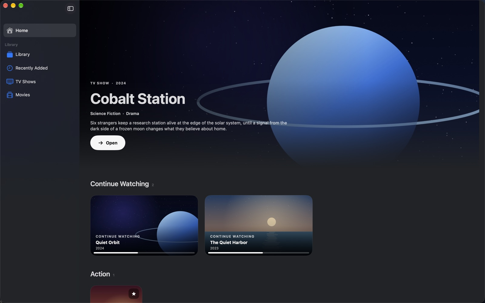
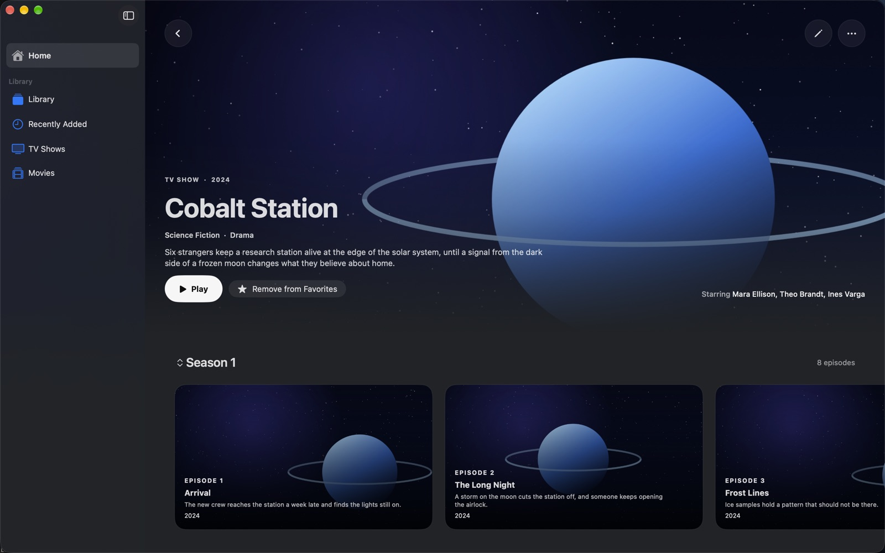
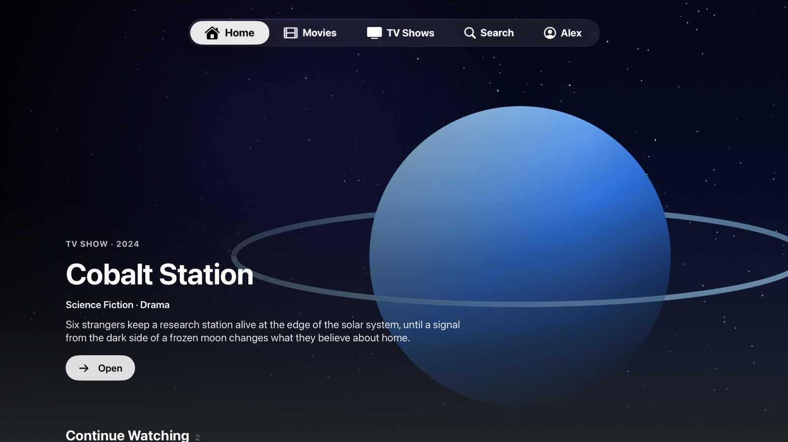
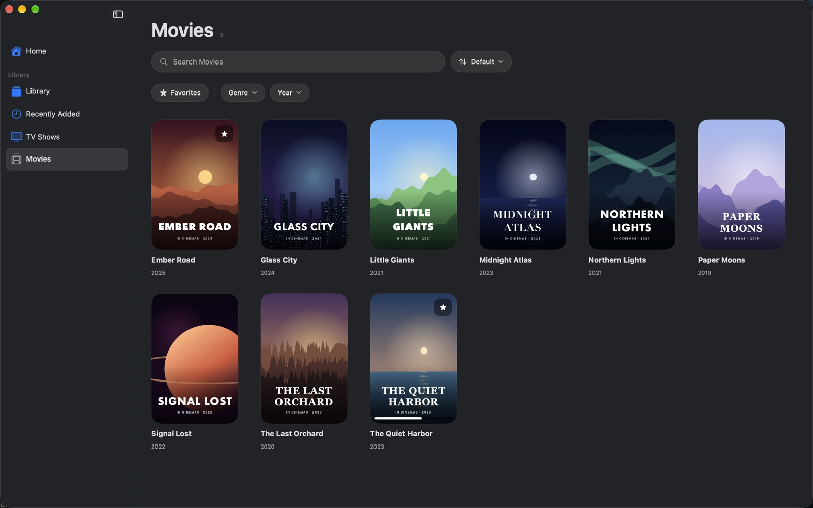
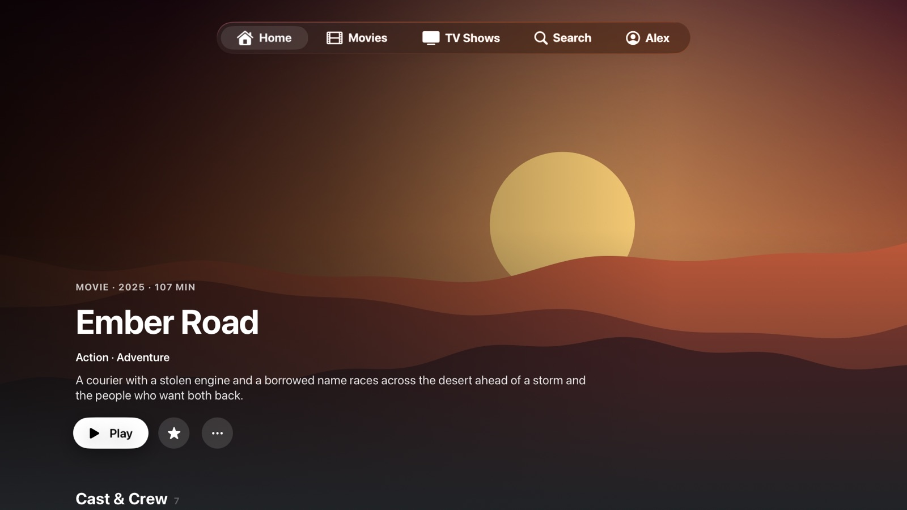
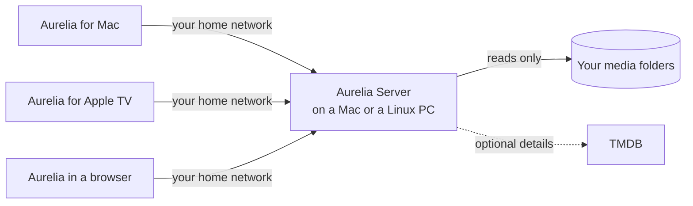

# Aurelia

**Your own movie and TV library, at home.**

A self-hosted media server for Mac or Linux, with native apps for Mac and Apple TV.

Aurelia turns the movies and series on your own drives into a library that looks and
feels like the Apple TV app: posters and backdrops, seasons and episodes, Continue
Watching across devices and a profile for everyone at home. Your files stay exactly
where they are, and nothing leaves your home network unless you want it to.

## Highlights

**A library that organizes itself.** Movies, series, seasons, episodes, extras and
trailers are recognized from your folders. An import preview shows what Aurelia found
before anything is added, and you can correct it first. Titles, descriptions, cast and
crew, covers and backgrounds can all be edited, and your corrections stay after later
scans. Online details are optional and use your own TMDB token.

**Made for watching.** Fullscreen playback of the original files, audio and subtitle
choices, Continue Watching, scene notes, a sleep timer and Night Mode, which keeps loud
scenes calm and dialogue clear. On Apple TV, scrubbing shows preview frames and the next
episode counts down in an Up Next card.

**Everyone gets their own profile.** Favorites, progress and notes are separate for each
person. Profiles can be protected with a PIN; owner and administrator profiles always
are.

**A server that gets out of the way.** Run it inside the Mac app or on its own on a Linux
computer, such as an old PC without a screen. On Linux it can sleep when nobody watches
and wakes again by Wake-on-LAN when you open Aurelia. Updates, power saving, accounts,
library permissions, devices and backups are all managed from the Mac app.

## Screenshots

| Mac | Apple TV |
| --- | --- |
|  |  |
|  |  |

All titles, pictures and names in these screenshots are invented and drawn by
`scripts/make-showcase.swift`.

## Your files stay yours

- Video files are only ever read: Aurelia never modifies, moves or copies them, and never
  stores converted video.
- Removing a title from the library never deletes its video.
- Media that goes offline keeps its details, favorites and progress until you remove it.
- Your library runs on your own hardware; nothing goes to a cloud service.

## Apps

| | Runs on | What it does |
| --- | --- | --- |
| **Aurelia for Mac** | macOS 26 or later, Apple silicon and Intel | Watch, manage the library, host the server or connect to one |
| **Aurelia for Apple TV** | tvOS 26 or later | Watch on the big screen; pairs with your server by code |
| **Aurelia Server for Linux** | x64 and arm64, with systemd | Runs the library on its own; updates from GitHub |
| **Aurelia in a web browser** | Safari, Chrome, Edge or Firefox at home | Browse and watch without installing an app; the server serves it and converts MKV and other files live |

## Getting started

1. **Set up the server.** Open Aurelia on a Mac and choose whether this Mac hosts your
   library or connects to an existing server. On a new host, create the owner profile,
   add your media folders and confirm the import preview. To use a Linux computer
   instead, follow [Aurelia Server on Linux](docs/LINUX_SERVER.md).
2. **Connect your Mac apps.** Another Mac connects with a pairing code that you create in
   *Settings › Server › Devices*.
3. **Add your Apple TV.** Open Aurelia on the Apple TV and choose your server. The TV shows
   a code; enter it on the Mac under *Settings › Server › Devices*.
4. **Open Aurelia in a browser** on any computer, phone or tablet at home; see
   [Watching in a web browser](#watching-in-a-web-browser).

Each [release](../../releases) carries the Linux server packages and a disk image of the
Mac app. The Mac app is currently signed for development, so it runs only on Macs
registered for the developer account; a download for everyone is planned through
GitHub, not the App Store.

To update the Mac app, choose *Aurelia › Check for Updates…*. It installs the newest
release from GitHub and keeps your library, settings and sign-ins; see
[Updating the Mac app](docs/FREE_DISTRIBUTION.md#updating-the-mac-app).

## Watching in a web browser

Rather watch in a browser? While the server is on, open its address in Safari, Chrome, Edge
or Firefox on any computer, phone or tablet at home, for example
`https://192.168.1.50:43111`. The Mac app shows the address with Copy and Open buttons under
*Settings › Server › Devices › Web Browser*.

1. **Continue past the certificate warning** the first time. The server signs its own
   certificate, so the browser doesn't know it yet.
2. **Approve the code.** The browser shows an 8-digit code; on the Mac, choose *Enter Code
   from Apple TV or Browser…* and type it.
3. **Choose your profile, type your PIN and watch.** Files the browser can't open itself,
   such as MKV, play live converted by the server; nothing converted is ever stored.

More in [Aurelia in a web browser](docs/WEB_APP.md).

## Documentation

| Guide | Covers |
| --- | --- |
| [Aurelia Server on Linux](docs/LINUX_SERVER.md) | Installing, updating, power saving and media drives |
| [Backups and recovery](docs/DATABASE_RECOVERY.md) | Keeping the library database safe |
| [Aurelia in a web browser](docs/WEB_APP.md) | Signing in, what plays in a browser, and its limits |
| [Client protocol](docs/CLIENT_PROTOCOL.md) and [compatibility](docs/CLIENT_COMPATIBILITY.md) | How the apps talk to the server |
| [Build and verification](docs/TRANSPORT_TESTING.md) | Building from source and running the checks |
| [Third-party notices](THIRD_PARTY_NOTICES.md) | Licenses of included components |

Aurelia is in active development. The interface is in English.

